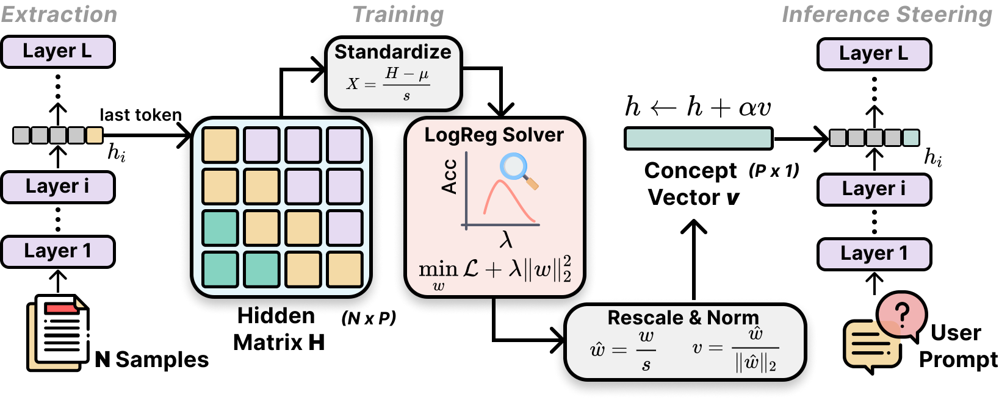
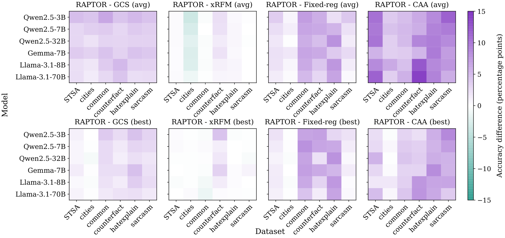

# RAPTOR: Ridge-Adaptive Logistic Probes

Ziqi Gao, Yaotian Zhu, Qingcheng Zeng, Xu Zhao, Ziqing Wang, Feng Ruan, Kaize Ding

**NeurIPS 2026**

[Paper](https://arxiv.org/abs/2602.00158v4) · [Quick Start](#quick-start) ·
[Experiments](#reproducing-the-experiments) · [Documentation](#documentation) · [Citation](#citation)

## Overview

RAPTOR learns binary concept probes from frozen language-model representations.
It selects the ridge strength of a logistic readout on held-out validation data,
refits with that choice, and returns an affine probe in the original activation
coordinates. The probe provides concept scores and directions for accuracy,
directional robustness, and separate steering workflows.

[](assets/raptor_overview.png)

*The paper's overview includes optional steering with a normalized direction.
The Quick Start returns the raw affine probe (`W`, `B`).*

## Main Results

The main accuracy benchmark covers **six models × six datasets × five methods**,
with shared outer split seeds **42–46**.

[](assets/accuracy_differences.png)

*RAPTOR minus each baseline, in percentage points: five-seed means for the full-layer
average (top) and validation-selected best-layer test accuracy (bottom).
Purple favors RAPTOR; green favors the baseline. Click either figure to enlarge.*

- **Accuracy.** RAPTOR's reported layer-average accuracy exceeds GCS, Fixed-reg,
  and CAA midpoint in all 36 settings; its comparison with xRFM varies by setting.
  Best layers are selected on shared outer validation, never on test accuracy.
  Tables report sample standard deviations across the five seeds.
  [Accuracy protocol and results](docs/accuracy.md).
- **Directional robustness.** Across 18 settings with repeated 20% training-pool
  ablations, RAPTOR's reported median layer-mean absolute cosine is **0.895**.
  This is a stability measure in each method's native coordinates, not a claim
  that RAPTOR is the most stable method. [Robustness details](docs/robustness.md).
- **Computational cost.** The repository provides a unified five-method CPU timing
  workflow with native fitting budgets. The paper's reported timings combine
  historical sources and do not establish a new controlled five-method speed
  comparison. [Timing results and reproduction](docs/timing.md).

These are reported paper results, separate from new runs of the public workflows.
[Figure sources and aggregation](docs/readme_assets.md) document the unchanged
paper artwork and the numeric evidence behind these statements.

## Installation

Use Python **3.9–3.12** (Python 3.11 is used in CI). From a terminal:

```bash
git clone https://github.com/Ziqi-Gao/RAPTOR.git
cd RAPTOR
python -m venv .venv
source .venv/bin/activate
python -m pip install --upgrade pip setuptools wheel
python -m pip install -e .
```

This core installation is enough for the example below; no PyTorch, GPU, model
weights, or dataset download is needed. See the [installation guide](docs/installation.md)
for five-method experiments, extraction, plotting, optional judging, and tested versions.

## Quick Start

Run a real RAPTOR probe on a small synthetic binary dataset:

```bash
python examples/minimal_probe.py
```

The example calls the existing API directly. `X` is one layer's representation
matrix of shape `(samples, features)`; `y` contains labels `0` and `1`.
Replace the synthetic arrays with your own frozen representations when ready.

```python
import numpy as np
from raptor.core import split_indices
from raptor.experiments.run_raptor import fit_raptor_layer

rng = np.random.default_rng(42)
y = np.repeat([0, 1], 125)
X = rng.normal(size=(250, 16)).astype(np.float32)
X[:, :3] += (2 * y - 1)[:, None]
train, val, test = split_indices(y, test_size=0.2, val_size=0.2, seed=42)

probe = fit_raptor_layer(
    X[train], y[train], X[val], y[val], X[test], y[test], seed=42
)
logits = X[test] @ probe["W"] + probe["B"]  # raw coordinates
predictions = (logits > 0).astype(int)
print("Selected C:", probe["best_C"])
print("Synthetic test accuracy:", probe["acc_test"])
print("Direction shape:", probe["W"].shape)  # (16,)
```

RAPTOR fits preprocessing on training rows, chooses `C` from its native 100-value
grid using validation accuracy, then refits on train + validation. The returned
`W` and `B` already include the preprocessing transformation; use them on raw
representations without another standardization step. The held-out test data is
scored only after selection and refit. `val_acc_pre_refit` retains the candidate's
validation accuracy.

This single-layer synthetic demonstration is **not a paper result**. The full
benchmark additionally selects layers on validation and repeats the shared split
protocol over five seeds. See the [API implementation](src/raptor/experiments/run_raptor.py)
and [accuracy guide](docs/accuracy.md).

## Reproducing the Experiments

Prepare the documented data and compatible embeddings before running a benchmark.
Each guide provides the complete commands, configurations, outputs, and resume rules.

| Experiment | Required inputs | Guide |
|---|---|---|
| Data and embedding preparation | Six source datasets; model access and weights for extraction | [Data and models](docs/data.md) |
| Main accuracy: five methods, five seeds | Complete layer embeddings for six models × six datasets | [Accuracy](docs/accuracy.md) |
| Grouped sensitivity: RAPTOR, xRFM, GCS | CounterFact/Cities embeddings and aligned subject/city IDs | [Grouped protocol](docs/accuracy.md) |
| Directional robustness: five methods | Three models × six datasets; complete cached layers | [Robustness](docs/robustness.md) |
| Computational cost: five methods | Main accuracy embeddings; supported CPU environment | [Timing](docs/timing.md) |
| Steering and control evaluation | Own-method probes, prompts, model weights; judge access only for optional scoring | [Steering](docs/appendix_and_steering.md#original-steering-and-actual-control-measurements) |
| Separability and structure diagnostics | Embeddings and the documented diagnostic configuration | [Appendix experiments](docs/appendix_and_steering.md) |
| Recompute reported summaries | Included numeric reference CSVs; no fitting | [Reported results](reported_results/README.md) |

CAA midpoint accuracy, raw mean-difference robustness, and optional CAA
scalar-logistic + GCAV steering are distinct experiment definitions. Grouped
sensitivity remains separate from the main five-method benchmark. [The paper-to-code map](docs/paper_map.csv)
lists the exact scope of every body and appendix experiment.

## Documentation

- [Installation and offline checks](docs/installation.md) · [Data and model preparation](docs/data.md)
- [Experiment protocols](docs/paper_map.csv) · [Reported numeric results](reported_results/README.md)
- [Sources and known limitations](docs/provenance.md) · [Validation record](docs/validation.md)
- [Figure sources](docs/readme_assets.md) · [Third-party assets and attribution](docs/assets.md)

Historical timing, robustness pairing, steering trajectories, and judge-score
provenance retain the limits documented above. Executable workflows and synthetic
checks do not imply that every paper experiment has been freshly reproduced.

## Citation

```bibtex
@misc{gao2026raptorridgeadaptivelogisticprobes,
  title={RAPTOR: Ridge-Adaptive Logistic Probes},
  author={Ziqi Gao and Yaotian Zhu and Qingcheng Zeng and Xu Zhao and Ziqing Wang and Feng Ruan and Kaize Ding},
  year={2026},
  eprint={2602.00158},
  archivePrefix={arXiv},
  primaryClass={cs.LG},
  url={https://arxiv.org/abs/2602.00158v4}
}
```

## License & Acknowledgments

The author-code license is **pending the authors' decision**. [LICENSE](LICENSE)
is a status notice, not an open-source license grant. The paper figures retain
their [separate attribution](docs/readme_assets.md); they do not license the code.

We acknowledge the upstream xRFM, neural-controller, model, and dataset projects.
Their licenses, attribution, and data-access restrictions are recorded in
[third-party notes](docs/assets.md) and [retained license notices](third_party/licenses).
